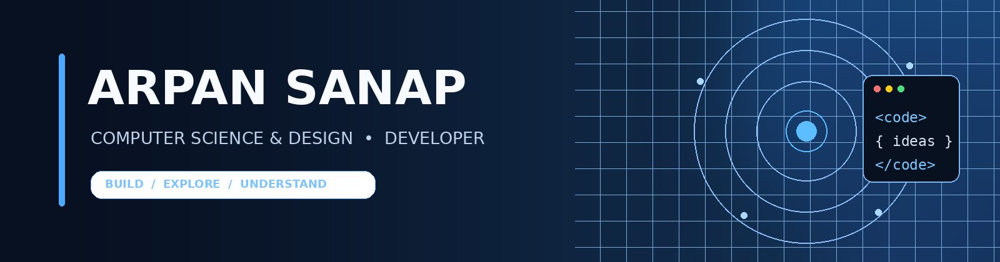

<!--
  GitHub Profile README
  Repository name: arpansanap1-stack
  Before publishing:
  1. Replace YOUR_BOOTDEV_GIT_CERTIFICATE_URL and YOUR_GITHUB_CERTIFICATE_URL.
  2. Add LinkedIn / portfolio links if you want them displayed.
  3. Confirm the project repository URLs and update them if any repo was renamed or made private.
-->

  

  

  

    
    
  

  
<em>Curious by nature. Building with purpose. Learning every day.</em>

---

## 👋 About Me

I'm **Arpan Sanap**, a Computer Science and Design engineering student who enjoys turning ideas into useful products. I like working at the intersection of **software engineering, problem-solving, and thoughtful design**.

I'm focused on building strong fundamentals, learning how real-world systems work, and creating projects that solve practical problems. I believe the best way to learn is to stay curious, build consistently, and understand the reasoning behind the code.

- 🎓 Computer Science & Design engineering student
- 🧠 Interested in software engineering, backend systems, AI, and product thinking
- 🛠️ Enjoy building web applications and experimenting with ideas
- 🌱 Currently strengthening my Python and computer science fundamentals
- 🎯 Working towards my first software engineering internship

## 🚀 Featured Projects

<table>
  <tr>
    <td width="50%" valign="top">
      <h3>🧠 Curiosity Machine</h3>
      
A space for exploring ideas, connecting thoughts, and going deeper into questions. Built around the belief that curiosity can become a powerful tool for learning.

      

        
        
      

    </td>
    <td width="50%" valign="top">
      <h3>📊 MarketPulse</h3>
      
A project exploring market-focused information and insights, with an emphasis on presenting useful signals in a clear, accessible way.

      

        
      

    </td>
  </tr>
  <tr>
    <td width="50%" valign="top">
      <h3>🔐 REVAULT</h3>
      
A digital forensics and secure data sanitization project explored for the Smart India Hackathon. Its planned areas include secure erasure, file recovery, and forensic workflows.

      
Project work · Team Dhairya

    </td>
    <td width="50%" valign="top">
      <h3>🌐 More Experiments</h3>
      
I also build smaller projects and prototypes while learning new concepts. Browse my repositories to see experiments, coursework, and ongoing work.

      

    </td>
  </tr>
</table>

## 🧰 Tech Stack

### Languages

  
  
  
  

### Web & Backend

  
  
  
  
  
  

### Databases, Tools & Platforms

  
  
  
  
  
  

These are technologies I've used, studied, or explored in projects. I'm continuously improving my proficiency in each area.

## 📚 Currently Learning

| Area | Focus |
| --- | --- |
| Python | Strengthening programming fundamentals and problem-solving |
| Linux | Command line, filesystems, permissions, and developer workflows |
| SQL | Relational databases, queries, joins, and data modelling |
| Core CS | Object-oriented programming, data structures, and algorithms |
| Software Engineering | HTTP, APIs, backend architecture, and maintainable code |

## 🏅 Certifications

| Certification | Issuer | Credential |
| --- | --- | --- |
| Git Certification | Boot.dev | [Add certificate link](YOUR_BOOTDEV_GIT_CERTIFICATE_URL) |
| Git & GitHub Certification | Add issuing platform | [Add certificate link](YOUR_GITHUB_CERTIFICATE_URL) |

> Replace the placeholder links and issuer details with the exact information shown on your certificates before publishing.

## 📈 GitHub Overview

  
  
   
  

## 🤝 Let's Connect

I'm always happy to connect with people who enjoy building, learning, and exchanging ideas.

- 💻 **GitHub:** [@arpansanap1-stack](https://github.com/arpansanap1-stack)
- 💼 **LinkedIn:** Add your LinkedIn profile
- 🌐 **Portfolio:** Add your portfolio when it is ready

---

  
<strong>“Stay curious. Build things. Understand deeply.”</strong>

  

